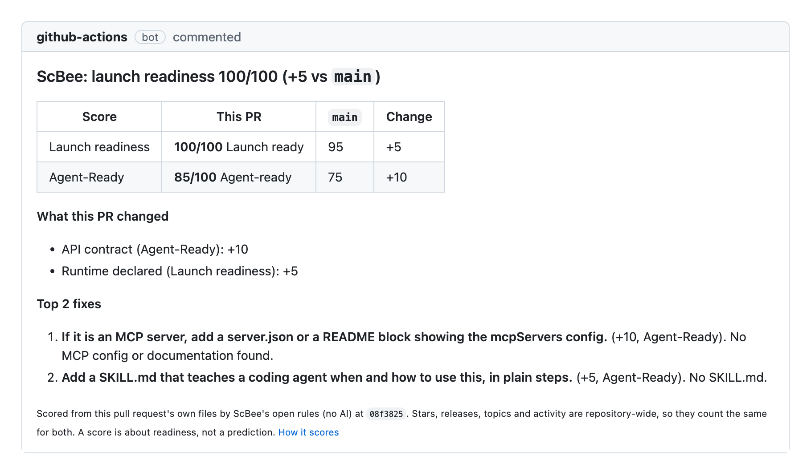

# ScBee PR score

Scores **this pull request's own files** for launch readiness and agent-readiness, compares them with the base branch, and keeps **one comment** on the pull request up to date with the score, the change, and the three fixes worth the most.



## Usage

```yaml
name: ScBee
on: pull_request
permissions: { contents: read, pull-requests: write }
jobs:
  scbee: { runs-on: ubuntu-latest, steps: [ uses: actions/checkout@v4, uses: HMAKT99/scbee-action@v1 ] }
```

The same, spelled out, with the optional check:

```yaml
name: ScBee
on: pull_request
permissions:
  contents: read
  pull-requests: write
jobs:
  scbee:
    runs-on: ubuntu-latest
    steps:
      - uses: actions/checkout@v4
      - uses: HMAKT99/scbee-action@v1
        with:
          fail-under: 70   # optional: fail the check below this launch readiness score
```

## Inputs and outputs

| Input | Default | What it does |
|---|---|---|
| `fail-under` | empty | Fail the check when this pull request's launch readiness is below this number (0 to 100). Empty never fails. |
| `github-token` | `${{ github.token }}` | Used only to write the one comment. |
| `path` | `.` | Folder of the checkout to score. |

Outputs: `score`, `agent-ready`, `score-change` (against the base branch).

## What it does, and what it never does

- **Scores the files in the pull request**, not the published repository, so the comment changes as you push. It reads the base commit with git to show the change. Stars, releases, topics and activity are repository-wide, so they count the same on both sides and never show up as a change.
- **Runs inside your workflow.** It does not send your code anywhere and does not call ScBee's servers. The only network reads are your repository's releases and tags on GitHub, and the npm registry when `package.json` names a published package. Private repositories work too.
- **Writes one comment, on the pull request that triggered it, in the repository it runs in**, with the workflow's own `GITHUB_TOKEN`. On later pushes it edits that comment instead of adding a new one.
- **Pull requests from forks**: GitHub gives them a read-only token, so the scores go to the job summary instead, and the run still passes.
- **Never fails your build by accident.** Only `fail-under` can fail the check. If it cannot comment (for example without `pull-requests: write`), it says so in the log and the job summary.
- **Never** comments, opens issues, stars, or writes anywhere outside the pull request it runs on.

The rules are open and fixed (no AI): <https://github.com/HMAKT99/ScBee>. A score says how easy a project is to understand, trust and try, and whether agents can use it. It is not a quality or security review. See any public repository's full report at <https://scbee.vercel.app>.

## Licence

Apache-2.0. Built from [`packages/pr-action`](https://github.com/HMAKT99/ScBee/tree/main/packages/pr-action) in the ScBee repository; issues and changes go there.
